# Gym Neutron — test report

Tested on 2026-10-24 by Dale Ysmael Landoy, Raiven Contreras and Jefferson Haresco.
All 16 cases below **passed**. The expired-promotion test (TC-08) is the mandatory one.

**Setup.** The site was served locally (`python -m http.server 5180`) and tested in Microsoft
Edge (Chromium) on Windows 11 with GPU WebGL. Viewports were set exactly with the DevTools
protocol (`tools/capture.mjs`) at 1440×900, 1280×800, 1024×700, 768×1024, 390×844 and 360×740.
Logic was unit-tested in Node with `npm test` (14 tests, 14 passed).

## Test cases

| ID | Feature | Steps | Expected | Result |
|---|---|---|---|---|
| TC-01 | Form: empty submit | Press **Claim my free 30 days** with every field empty | Summary "Please fix 5 fields…", a message under each field, fields marked invalid, focus moves to Full name | Pass |
| TC-02 | Form: bad email and mobile | Name "Juan Dela Cruz", email `juan@gmail`, mobile `0900`, time and consent filled; submit | Email: "That email doesn't look right…"; Mobile: "Use an 11-digit PH mobile number…"; focus moves to Email; no confirmation | Pass |
| TC-03 | Form: consent required | Valid name, email, mobile, time; consent unticked; submit | "Tick this box so we're allowed to contact you about your spot."; no confirmation | Pass |
| TC-04 | Form: valid, simulated success | Valid details, consent ticked, buddy ticked; submit | Form replaced by "You're in, Juan." with the dummy number `0900 000 0000` normalised to 09000000000; focus moves to the confirmation | Pass |
| TC-05 | Form: no data stored or sent | Run TC-04, then check localStorage, sessionStorage, network requests and the URL | Storage unchanged, zero new network requests, no personal data in the URL | Pass |
| TC-06 | Form: name rules | Unit tests: "Juan", "J", "Juan 123", "María-Luz O'Neil" | Last name required, minimum 2 letters, letters only, accents and hyphens accepted | Pass |
| TC-07 | Countdown: active | Open the page on 2026-10-24 | Shows days, hours, minutes, seconds to Nov 30, 2026, 11:59:59 PM PHT, ticking each second; matches `getCountdown()` | Pass |
| **TC-08** | **Countdown: expired state (mandatory)** | Open `/?now=2026-12-01T00:00:00+08:00` | Countdown hidden; "The Confidence Catalyst has closed." shown; form hidden and its button disabled; a forced submit shows no confirmation; header and hero buttons change to "Offer ended" / "See what's next" | Pass |
| TC-09 | Countdown: live switch at the deadline | Open `/?now=2026-11-30T23:59:50+08:00` and wait 11 seconds | Counts down from 00:00:00:06, then switches to the expired state without a reload | Pass |
| TC-10 | Countdown: boundary | Unit tests at deadline − 1 s, at the deadline, and after | Active at −1 s; expired at exactly the deadline; never negative after | Pass |
| TC-11 | Quiz: answer required | Press **Next** without picking an answer | "Pick one answer to continue." and it stays on question 1 | Pass |
| TC-12 | Quiz: result | Answer Fe, Fe, O, Fe | Result tile "26 Fe Iron", "Iron: Strength starter", 3-line plan, focus moves to the result; the element is passed to the form for the confirmation | Pass |
| TC-13 | Quiz: tie rule | Answer O, Fe, Fe, O | Tie goes to the first answer: Oxygen | Pass |
| TC-14 | Responsive layout | Load at 1440, 1280, 1024, 768, 390 and 360 px wide and scroll every section | No horizontal scroll at any width (scrollWidth = clientWidth); nav collapses into **Menu** below 900 px; offer stage fits at 1024×700 | Pass |
| TC-15 | 3D fallback | Open `index.html` straight from disk (`file://`), where browsers block ES modules | 3D skipped, gradient backdrop shown; countdown, form and quiz still work | Pass |
| TC-16 | Reduced motion | Emulate `prefers-reduced-motion: reduce` | No smooth-scroll library, no entrance animation, scene renders still frames only | Pass |

## Also checked

- **HTML:** one `h1`, no duplicate ids, every input and select has a label, every in-page link
  points to an existing id, semantic `header`, `nav`, `main`, `section`, `article`, `footer`.
- **Separation:** HTML, CSS and JS in separate files; no inline styles in the source; all paths relative.
- **Console:** no errors or warnings at any tested viewport.
- **3D performance:** pixel ratio capped (2 desktop, 1.5 phone); bloom, grain and the clear-coat
  material only on desktop; the render loop pauses when the tab is hidden.

## Known limits

- The 3D libraries (Three.js, GSAP, Lenis) load from public CDNs, so the 3D needs an internet
  connection and an `http(s)` address. The page itself works without them (TC-15).
- The confirmation is simulated, as the brief requires. A real launch would connect the form to
  the front desk's booking system.

## Screenshots

| | |
|---|---|
| 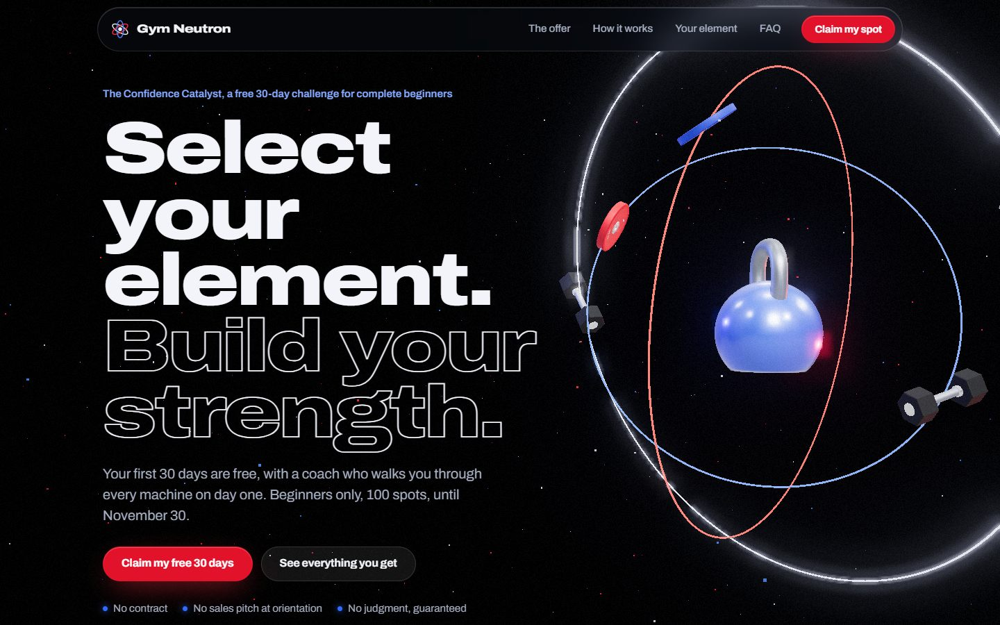 Hero, desktop | 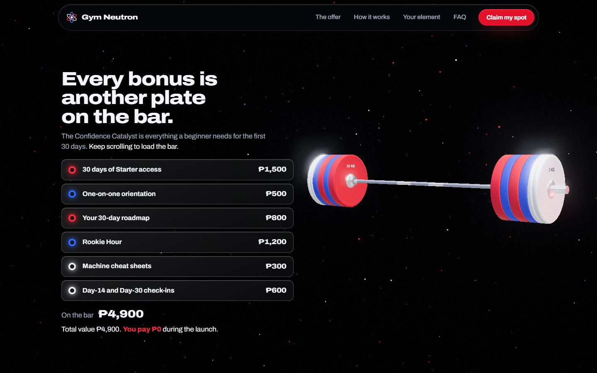 TC-14 offer stage, all six plates loaded |
| 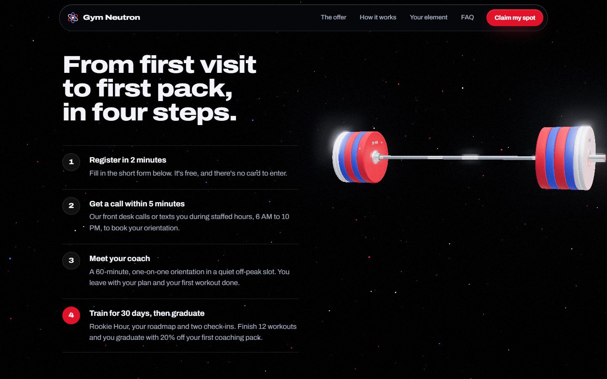 How it works | 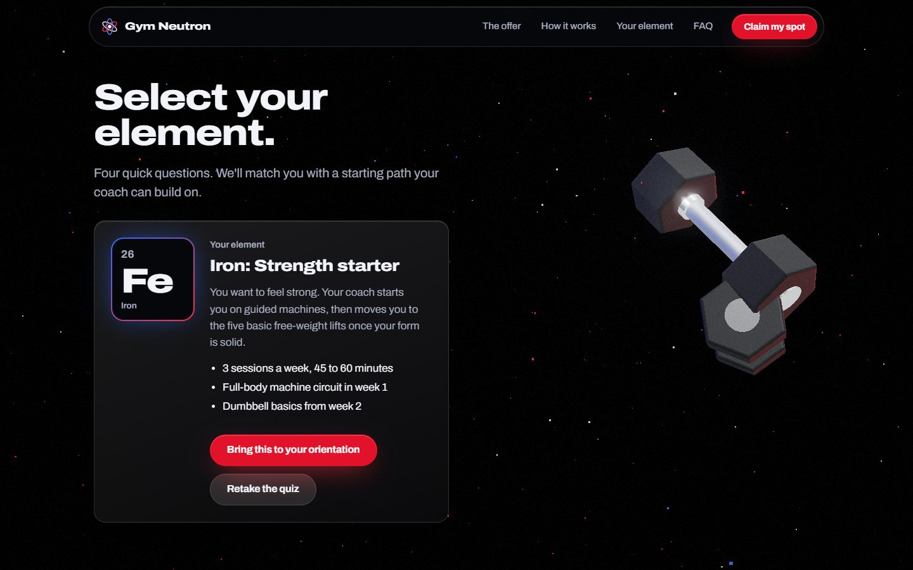 TC-12 quiz result |
| 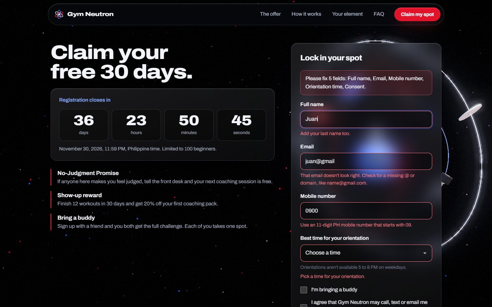 TC-01/02 validation messages | 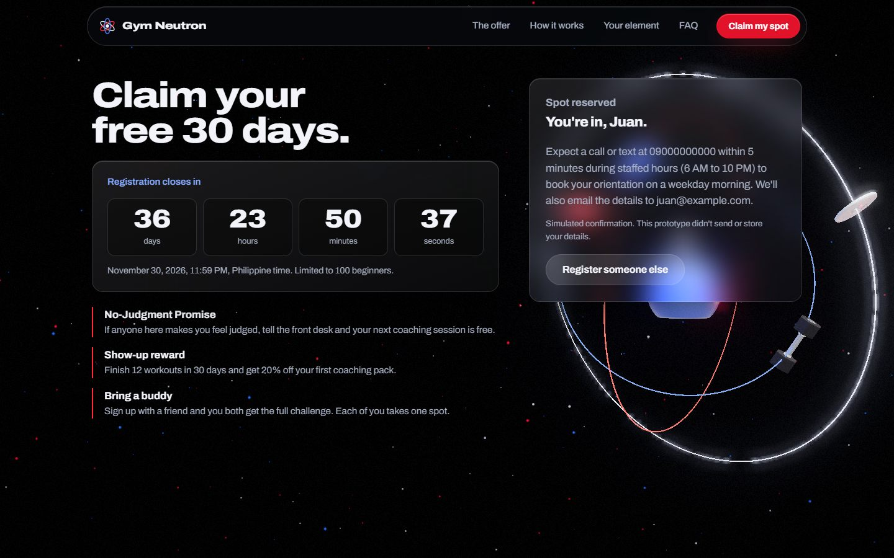 TC-04 simulated confirmation |
| 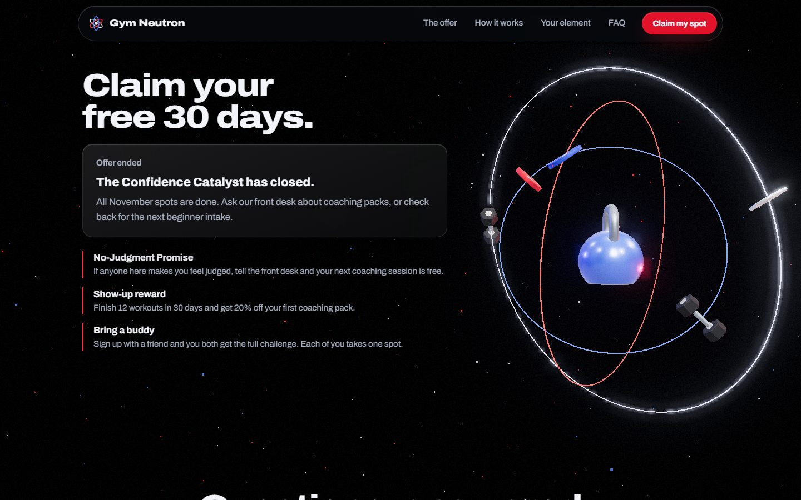 **TC-08 expired state, desktop** | 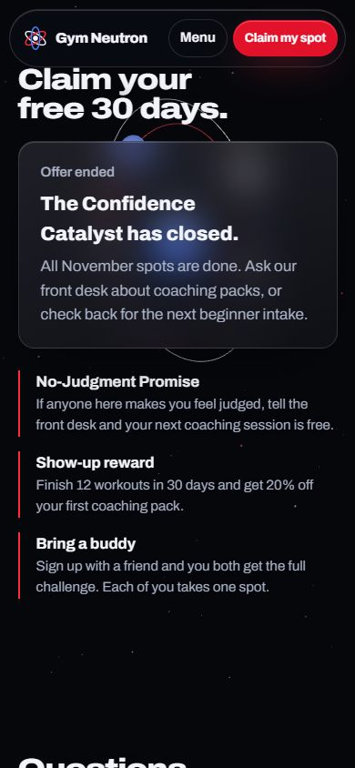 **TC-08 expired state, phone** |
| 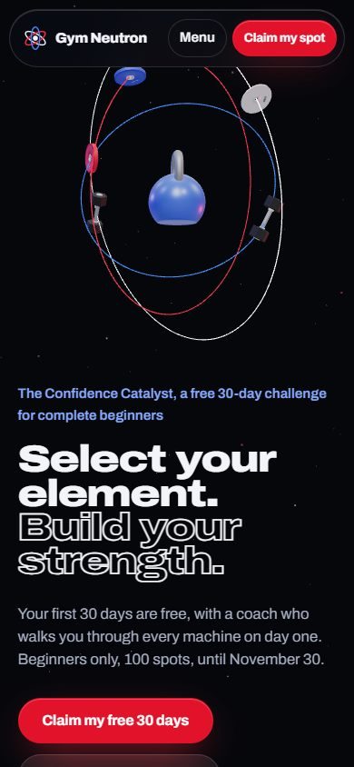 Hero, 390 px phone | 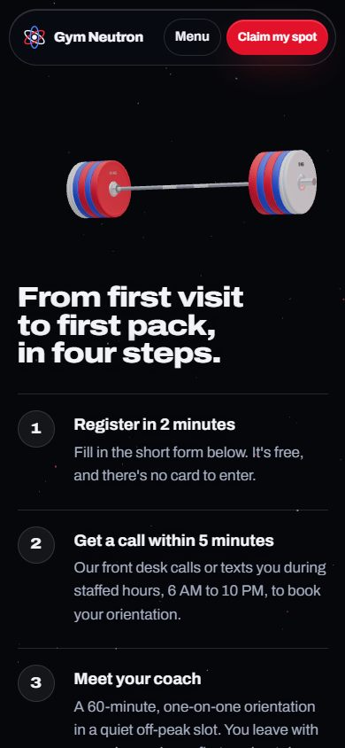 How it works, phone |
| 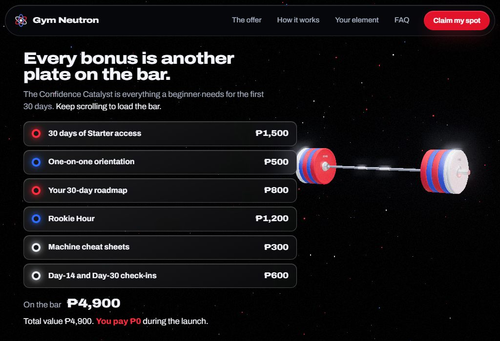 TC-14 offer at 1024×700 | 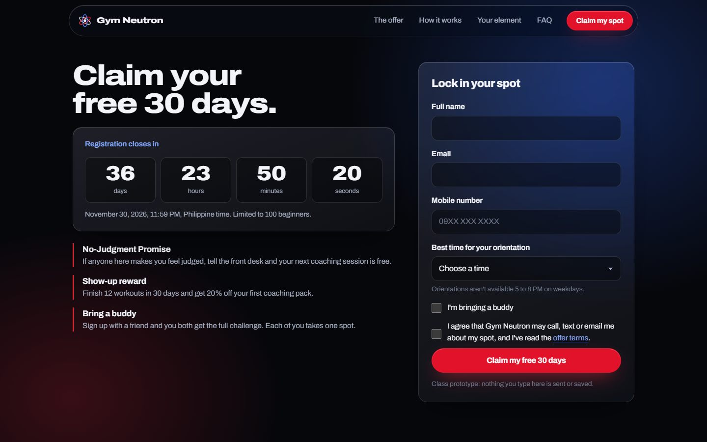 TC-15 fallback without 3D |

## How to rerun

```
npm test                                   # unit tests
python -m http.server 5180 --bind 127.0.0.1
node tools/capture.mjs --width 1440 --height 900 --out captures/desktop
node tools/capture.mjs --width 390 --height 844 --mobile --out captures/mobile
powershell -File tools/states.ps1          # form, confirmation and quiz states
```
